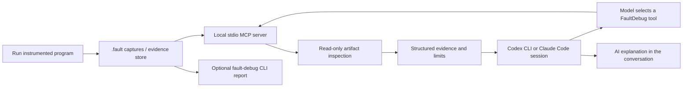

# FaultDebug

> Turn C/C++ crashes into source-verified execution-flow reports.
> Follow recorded calls across services, inspect the fault location, and see
> which evidence is missing.

[](docs/releases/v1.3.0-alpha.31.md)
[](https://github.com/lsh235/FaultDebugMCP/actions/workflows/v12-release-gate.yml)
[](https://www.python.org/)
[](https://clang.llvm.org/)
[](LICENSE)

**Guides:** [English](README.md) · [한국어](README.ko.md) · [简体中文](README.zh-CN.md) · [日本語](README.ja.md)

**[Try the interactive demos](https://lsh235.github.io/FaultDebugMCP/)** ·
**[Watch the 42-second walkthrough](https://lsh235.github.io/FaultDebugMCP/assets/demo.webm)** ·
**[Run the fixture locally](#try-the-prebuilt-demo)** ·
[Share feedback](https://github.com/lsh235/FaultDebugMCP/discussions)


Explore a [successful checkout](https://lsh235.github.io/FaultDebugMCP/reports/success/report.html),
[payment SIGILL](https://lsh235.github.io/FaultDebugMCP/reports/payment_crash/report.html),
[inventory timeout](https://lsh235.github.io/FaultDebugMCP/reports/inventory_timeout/report.html),
or [native C SIGSEGV](https://lsh235.github.io/FaultDebugMCP/reports/c-sigsegv/report.html).
The online examples are recorded synthetic executions; the local fixture
reproduces real Docker service interactions and native captures.

## Try the prebuilt demo

Requires **Linux x86_64, a local Docker Engine and Docker Compose**. After cloning,
one script downloads the checksummed development demo image, runs eight services
through three outcomes and serves the reports. No host Python, Clang or CMake
installation is needed.

~~~~sh
git clone https://github.com/lsh235/FaultDebugMCP.git
cd FaultDebugMCP
./scripts/try-demo.sh
~~~~

Open **http://127.0.0.1:18870/index.html** when the script prints the report URL.
Ctrl+C stops the report server. The analyzer uses the local Docker socket to
manage its own fixture containers. See [requirements and overrides](docs/showcase/README.md).
The shopping app is Python with an instrumented C++ boundary; these are native
boundary events, not Python stacks. Incomplete captures remain marked incomplete.

## Native tracing and inspection

FaultDebug combines a small C11 runtime, C/C++ build integration, and a Python
CLI/MCP inspector. The runtime records bounded function-entry and function-exit
events while an instrumented program runs. After the target exits, the local
launcher collects and validates the shared-memory trace and may write a
`.fault` artifact for a supported fatal signal or partial termination.


FaultDebug is designed to preserve evidence and its limits. It does not guess
missing events, infer causality from process names or shared IDs, or present
static call-graph candidates as observed execution.

## Project status

The development package is **1.3.0a31** (`v1.3.0-alpha.31`); the evidence-foundation
baseline is [v1.2.0-rc.2](https://github.com/lsh235/FaultDebugMCP/releases/tag/v1.2.0-rc.2).
The existing-project path provides static ELF preflight and isolated opt-in
CMake integration. `faultdebug self-test` verifies one bounded installed capture;
alpha9 added `faultdebug integrate --execute-build` for the isolated
configure/build/index/bundle path. Alpha10 adds a second explicit opt-in,
`--execute-target`, to run the built target with repeated `--target-arg` values
and validate one complete, stable, loss-free capture. None runs by default.
Alpha11 adds the explicit `--fault-report` handoff after the verified capture;
alpha12 adds `--fault-report-language en|ko` while keeping English as the
default. Alpha13 adds `--fault-report-max-events 1..500` while keeping the
80-event default and omitted-view accounting. Meson adoption remains deferred
until it can meet the existing source-provenance contract. Alpha14 adds
`--fault-report-output PATH` for a new caller-selected report directory while
preserving the adjacent-to-capture default. Alpha15 marks the verified bundle
required in the MCP schemas for source lookup and static call relations, matching
their existing runtime behavior. Alpha16 adds bounded, read-only `discover_bundles`
so MCP clients can locate candidate source bundles before calling those tools; it
does not verify candidates until a source tool consumes one.
Alpha17 adds `--tool-profile focused`, a 15-tool evidence workflow for smaller
MCP catalogs; the default `full` profile preserves all 27 tools. Alpha18 moves
to the official MCP Python SDK v1.30 and publishes validated structured-output
schemas for capabilities, store health, artifact discovery and bundle discovery.
It adds a machine-readable response channel while retaining text results. The
four schemas are real-protocol tested; an official Glama score change still
requires an external pin, deployment and rescan. Alpha19 adds distinct,
task-specific top-level display titles for all 27 tools and aligns them with
the annotation titles; both MCP profiles are checked over stdio. Alpha20 adds
a typed structured result for verified function source while preserving the
text response. Alpha21 adds documented success/error output schemas for
`list_incidents`; dynamic incident evidence payloads remain outside that schema.
Alpha22 adds a six-field typed result for full-profile `list_sessions` while
keeping the focused catalog and its scope unchanged. The score still needs an
external Glama re-scan. Alpha23 adds a typed verified-citation/error contract
for `get_source_evidence` in both profiles while retaining the existing text
shape and single-citation convenience fields.
Alpha24 adds typed normalized RPC observations and six explicit diagnostic
variants for `get_rpc_trace` in both profiles; static candidates remain open
producer-owned JSON. The text shape and pagination are unchanged, and Glama
score impact remains unverified. Alpha25 adds a typed `get_fault_flow` execution
view in both profiles, including thread events, crashes, gaps, address
resolution and verified-source markers. It preserves the text result and
capture boundaries; Glama score impact remains unverified.
Alpha26 tailors eight descriptions in the focused profile so named alternatives
are selectable within its 15-tool catalog; the 27-tool full profile retains its
existing guidance. No runtime behavior or tool inventory changes, and Glama
score impact remains unverified. Alpha27 publishes a typed `get_incident_report`
contract in both profiles, including observed RPC events and paging while
preserving dynamic evidence rows; its score impact remains unverified. Alpha28
adds a typed per-address `resolve_addresses` result in both profiles so callers
can read function IDs, Build-ID matches and unresolved reasons as structured
data. Resolver behavior is unchanged and Glama score impact remains unverified.
Alpha29 publishes the typed `get_call_relations` envelope in both profiles while
keeping producer-defined static relation rows open; its score impact remains
unverified. Alpha30 types the `get_thread_trace` page and raw thread/event rows in both
profiles while preserving unknown fields, conditional retention and evidence
boundaries. Alpha31 adds a typed success/error contract for `get_incident_slice`
in both profiles, keeps SQLite extensions and producer payloads open, and retains
the existing pagination, text response and evidence limits. Glama score impact
remains unverified. See the
[call-relations output-schema research](docs/mcp-call-relations-output-research.md),
[call-relations output-schema review](docs/mcp-call-relations-output-review.md),
[alpha29 scope and verification](docs/releases/v1.3.0-alpha.29.md),
[thread-trace output-schema research](docs/mcp-thread-trace-output-research.md),
[thread-trace output-schema review](docs/mcp-thread-trace-output-review.md),
[alpha30 scope and verification](docs/releases/v1.3.0-alpha.30.md),
[incident-slice output-schema research](docs/mcp-incident-slice-output-research.md),
[incident-slice output-schema review](docs/mcp-incident-slice-output-review.md),
[alpha31 scope and verification](docs/releases/v1.3.0-alpha.31.md),
[adoption guide](docs/existing-project-adoption.md),
[report-output review](docs/integration-report-output-review.md), and
[MCP bundle review](docs/mcp-required-bundle-review.md),
[bundle-discovery review](docs/mcp-bundle-discovery-review.md),
[MCP profile review](docs/mcp-profile-review.md),
[structured-output review](docs/mcp-output-schema-review.md), and
[display-title research](docs/mcp-tool-title-research.md),
[display-title review](docs/mcp-tool-title-review.md), and
[source output-schema research](docs/mcp-source-output-research.md),
[source output-schema review](docs/mcp-source-output-review.md), and
[incident-list output-schema research](docs/mcp-incident-list-output-research.md),
[incident-list output-schema review](docs/mcp-incident-list-output-review.md),
[session-list output-schema research](docs/mcp-session-list-output-research.md),
[session-list output-schema review](docs/mcp-session-list-output-review.md),
[source-evidence output-schema research](docs/mcp-source-evidence-output-research.md),
[source-evidence output-schema review](docs/mcp-source-evidence-output-review.md),
[RPC trace output-schema research](docs/mcp-rpc-trace-output-research.md),
[RPC trace output-schema review](docs/mcp-rpc-trace-output-review.md), and
[fault-flow output-schema research](docs/mcp-fault-flow-output-research.md),
[fault-flow output-schema review](docs/mcp-fault-flow-output-review.md), and
[focused-profile description research](docs/mcp-focused-description-research.md),
[focused-profile description review](docs/mcp-focused-description-review.md), and
[address-resolution output-schema research](docs/mcp-address-resolution-output-research.md),
[address-resolution output-schema review](docs/mcp-address-resolution-output-review.md), and
[evidence-summary candidate research](docs/mcp-evidence-summary-output-research.md),
[evidence-summary candidate review](docs/mcp-evidence-summary-output-review.md), and
[alpha28 scope and verification](docs/releases/v1.3.0-alpha.28.md), and
[incident-report output-schema research](docs/mcp-incident-report-output-research.md),
[incident-report output-schema review](docs/mcp-incident-report-output-review.md), and
[alpha27 scope and verification](docs/releases/v1.3.0-alpha.27.md), and
[alpha26 scope and verification](docs/releases/v1.3.0-alpha.26.md).

Final independent stable acceptance, current-revision full core/gRPC profiles,
kind and fresh 30-minute soak remain pending. Docker 8/16/32 results cover only
the bounded scenarios listed in this milestone's verification record. Historical gate/soak
results apply only to their recorded revisions; the earlier soak retained
explicit loss ([historical validation](docs/v1.2-p3-01.md)).
The [v1.3 plan](docs/next-version-v1.3.md) tracks the remaining work.

## What it provides

- **Bounded runtime tracing:** per-thread event rings, committed-record checks,
  module identity, signal metadata, and explicit overflow/partial status.
- **Post-exit collection:** the launcher owns the shared-memory descriptor and
  readiness handshake; collection happens after the target exits.
- **Verified source lookup:** immutable source snapshots, compile databases,
  Build IDs, and hashes are checked before source-backed inspection.
- **Local evidence workflows:** CLI and read-only MCP tools for artifact
  inspection, process/session grouping, evidence-store queries, and explicitly
  supported RPC/IPC relationships.
- **Build integration:** CMake helpers and compiler wrappers for C/C++ builds,
  including opt-in source-selection profiles.

Normal successful runs do not write a fault artifact unless
`--collect-success` is requested. A crash artifact may still be incomplete;
check its trace, dropped-event, snapshot, and collector status before relying on
it.

## Why FaultDebug

- Record function-level runtime events in a bounded C11 recorder without
  requiring a tracing daemon or remote service.
- Tie source lookup to captured build inputs, hashes, and module Build IDs so a
  changed checkout is not mistaken for the source that produced an artifact.
- Use a local CLI or read-only MCP server to inspect artifacts and explicitly
  separate observed events, static candidates, and unresolved evidence.
- Keep overflow, incomplete snapshots, and missing optional evidence visible.

Practical examples: [payment process crash](docs/case-studies/payment-crash.md),
[inventory timeout](docs/case-studies/inventory-timeout.md), and
[native C SIGSEGV](docs/case-studies/c-sigsegv.md).

The runtime currently targets Linux on Ubuntu 24.04 x86_64. It is a diagnostic
and forensic aid, not a lossless recorder: inspect artifact completeness and
drop counts before drawing conclusions.

## Supported environment

The documented support target is Ubuntu 24.04 x86_64 with Python 3.12, Clang
18, CMake 3.20 or newer, and Ninja. The recorder is C11; the native fixtures
also exercise C++17. Other platforms and compiler versions are outside the
current support commitment.

Python dependencies are pinned in [`pyproject.toml`](pyproject.toml):
`libclang`, `pyelftools`, and the MCP SDK. Fault artifacts, source bundles, and
the MCP interface are local-only. Remote transport and encryption are not
provided.

## Quick start

For an existing project, use the [isolated adoption guide](docs/existing-project-adoption.md):
`faultdebug preflight` checks an existing ELF without launching it, and
`faultdebug integrate` prepares a separate CMake build and evidence workflow.

Clone the repository:

```sh
git clone https://github.com/lsh235/FaultDebugMCP.git
cd FaultDebugMCP
```

Install the native toolchain and Python environment:

```sh
sudo apt-get update
sudo apt-get install clang-18 llvm-18-tools cmake ninja-build python3.12 python3.12-venv

python3.12 -m venv .venv
.venv/bin/python -m pip install --upgrade pip
.venv/bin/python -m pip install -e .
```

If you prefer [`uv`](https://docs.astral.sh/uv/), replace the three Python
environment/install commands above with the following. The apt-installed
native toolchain is still required for tracing builds:

```sh
uv venv --python 3.12 .venv
uv pip install --python .venv/bin/python -e .
```

Configure and build the runtime plus the native fixtures:

```sh
cmake -S . -B build -G Ninja \
  -DCMAKE_C_COMPILER=clang-18 \
  -DCMAKE_CXX_COMPILER=clang++-18 \
  -DFAULTDEBUG_PYTHON_EXECUTABLE="$PWD/.venv/bin/python" \
  -DFAULTDEBUG_BUILD_TESTS=ON
cmake --build build --parallel 2
```

Check the local environment and run a fixture:

```sh
export FAULTDEBUG_REAL_CC=clang-18
export FAULTDEBUG_REAL_CXX=clang++-18
.venv/bin/fault-debug doctor
.venv/bin/fault-debug self-test
.venv/bin/fault-debug capabilities
.venv/bin/fault-debug run --artifact-dir artifacts -- build/test/fd_c_chain 16
```

`self-test` compiles and runs a generated smoke fixture and verifies its
temporary trace; it does not run your project or validate source resolution.

The normal fixture exits successfully and does not create a `.fault` file.
To exercise a SIGSEGV capture, run:

```sh
.venv/bin/fault-debug run --artifact-dir artifacts -- build/test/fd_signals 11
```

The target's SIGSEGV produces the usual signal-based shell status (139) and a
`fault-<pid>.fault` artifact under `artifacts/`. The artifact is evidence of
the recorded run, not a guarantee that every event was retained.

For builds without system packages, see the repository's
[Clang 18 setup](docs/clang18-ci.md). For the complete validation matrix, see
[`test/README.md`](test/README.md).

## Inspecting and sharing evidence

Inspect an artifact locally:

```sh
.venv/bin/fault-debug inspect artifacts/fault-<pid>.fault
```

Source and call-relation lookup requires a verified bundle. Create an index
from the CMake compilation database and bundle the captured source and target
binary:

```sh
.venv/bin/fault-debug index build/compile_commands.json -o build/index.json
.venv/bin/fault-debug bundle \
  --source-root build/faultdebug-source-snapshot/files \
  --index build/index.json \
  --binary build/test/fd_c_chain \
  --output build/bundle
.venv/bin/fault-debug inspect artifacts/fault-<pid>.fault --bundle build/bundle
```

Bundles bind source and index data to the binary Build ID and hashes. Missing
or mismatched inputs fail explicitly; the current worktree is not substituted
for missing captured source.

Create a shareable fault document and interactive execution-flow view:

```sh
.venv/bin/fault-debug fault-report artifacts/fault-<pid>.fault \
  --bundle build/bundle --output reports/incident-001
# Open reports/incident-001/report.html; document: report.md; evidence: report.json
```

The standalone HTML highlights the captured fault PC and retained function
events, supports thread selection, search, dark/light themes, and document
printing to PDF. Gaps, unresolved addresses, and static call candidates remain
explicit. Use `--language ko` for Korean and `--max-events 200` for a larger
window. See the [fault-flow report guide](docs/fault-flow-report.md).


Try a larger, real cross-process workload with the
[N-process shopping fault lab](docs/shopping-fault-lab.md): eight core Docker
services plus optional risk workers, concurrent orders, controlled failures,
and a report of observed service-to-service RPC flow and failure evidence.

```sh
docker build -f test/shop/Dockerfile -t faultdebug-shop:dev .
.venv/bin/python test/shop/run.py --processes 16 --requests 24 --concurrency 4 \
  --scenarios success payment_decline --output build/shop-scale
```


### Use FaultDebug from an AI session

FaultDebug does not run an AI model or send data to an AI provider. Codex CLI,
Claude Code, or another MCP client runs the model conversation. When you ask it
to investigate a captured failure, the client can start this local stdio MCP
server, expose its read-only tools to the model, and pass tool results back into
the same conversation. The model decides which available tools to call and
explains the returned evidence.

The AI client can send these tool results to its configured model provider;
local MCP transport does not imply local AI inference.

The target program must already have been run with FaultDebug instrumentation,
and its `.fault` captures or evidence store must be available on disk. Connecting
an AI session does not start tracing or create those runtime captures. “AI
session” means the Codex/Claude conversation; a FaultDebug runtime session is a
separate group of captured process evidence.



#### Codex CLI

After installing the project with `pip install -e .`, register the server with
absolute paths to the installed CLI and the directory containing the captures:

```sh
codex mcp add faultdebug -- \
  /absolute/path/to/FaultDebugMCP/.venv/bin/python \
  -m faultdebug.cli mcp --root /absolute/path/to/artifacts
codex mcp list
```

Restart or open a Codex session in a trusted project, then use `/mcp` in the
Codex TUI to inspect connected servers. Codex CLI and its supported desktop/IDE
surfaces share MCP configuration. Alternatively, add the server to
`~/.codex/config.toml`:

```toml
[mcp_servers.faultdebug]
command = "/absolute/path/to/FaultDebugMCP/.venv/bin/python"
args = ["-m", "faultdebug.cli", "mcp", "--root", "/absolute/path/to/artifacts"]
```

#### Claude Code

Claude Code can register the same local stdio command. Project scope stores the
entry in the project configuration; Claude Code may ask you to approve it when
you open the project.

```sh
claude mcp add --scope project faultdebug -- \
  /absolute/path/to/FaultDebugMCP/.venv/bin/python \
  -m faultdebug.cli mcp --root /absolute/path/to/artifacts
claude mcp list
```

In Claude Code, run `/mcp` to check the connection and available tools. To keep
the server only in your user configuration, replace `--scope project` with
`--scope user`.

#### Ask about a captured failure

Once connected, ask the AI to inspect a concrete artifact. For example:

> Inspect `fault-1234.fault`. Show the recorded execution flow to the fault,
> identify which observations are direct evidence versus static candidates,
> and state what cannot be established from this capture.

For a single-process capture, the model can call `open_fault` and
`get_fault_flow`; for recorded RPC observations it can call `get_rpc_trace`.
For multiple process captures, it can use `get_session_manifest`,
`get_process_relations`, or `get_incident_report`. To inspect indexed source it
can use `get_function_source` with a verified bundle. Tool results include
evidence categories and known gaps so the model can explain the actual recorded
flow without treating a static candidate or inferred grouping as proven
causality.

The MCP tools only return data to the conversation; they do not write report
files. To create a durable Markdown, JSON, and interactive HTML report, run the
CLI separately:

```sh
.venv/bin/fault-debug fault-report artifacts/fault-1234.fault \
  --output reports/incident-001
```

For other MCP clients that accept the common `mcpServers` configuration shape,
use absolute paths:

```json
{
  "mcpServers": {
    "faultdebug": {
      "command": "/absolute/path/to/.venv/bin/fault-debug",
      "args": ["mcp", "--root", "/absolute/path/to/artifacts"]
    }
  }
}
```

The server is read-only. It does not upload artifacts or contact a remote
service. Do not expose sensitive fault artifacts, bundles, or source paths in
public issues. To run the MCP inspector in a container with a read-only artifact
mount, see the [Docker MCP guide](docs/mcp-container.md).

This CLI registration pattern follows the client-specific MCP commands in the
[Codex MCP guide](https://developers.openai.com/codex/mcp) and
[Claude Code MCP guide](https://code.claude.com/docs/en/mcp). The separate
manual-start note and explicit tool workflow follow common local-stdio MCP
project documentation such as [denysvitali/codex-mcp](https://github.com/denysvitali/codex-mcp).

The 26 MCP tools publish parameter descriptions, validated limits/enums and
read-only annotations. Their stdio definitions and non-mutating behavior are
checked in CI. See [MCP definition verification and Glama](docs/mcp-container.md#tool-definitions-and-glama)
for the local audit command and registry re-evaluation steps.

## Evidence rules

FaultDebug keeps these result classes separate:

- **Observed:** committed runtime records and explicitly matching RPC/IPC
  endpoints present in the captured evidence.
- **Static candidates:** possibilities from source or compilation data; these
  are not proof that a function executed.
- **Unresolved:** missing, ambiguous, partial, malformed, or untrusted evidence.

A shared trace ID, parent PID, function name, or timestamp alone does not prove
cross-process causality. The semantic RPC sidecar is optional and versioned;
older artifacts remain readable and report unavailable RPC evidence as
unresolved. See the [RPC evidence contract](docs/rpc-analysis-v1.md) and
[artifact format](docs/format.md).

## Development

Run the named native tests and launcher acceptance suite:

```sh
ctest --test-dir build --output-on-failure
FD_LAUNCHER="$PWD/.venv/bin/fault-debug" \
  .venv/bin/python test/run_tests.py --suite smoke --output test-results/smoke
```

Changes to artifact, ABI, source-bundle, or MCP contracts should include
malformed-input and compatibility coverage. The v1.2 profile runner and
scheduled/manual GitHub Actions workflow are documented in
[`docs/clang18-ci.md`](docs/clang18-ci.md). Report files, build trees, and
`.fault` artifacts are generated locally and are not part of the source upload.

Before opening a pull request, read
[`CONTRIBUTING.md`](CONTRIBUTING.md) and
[`SECURITY.md`](SECURITY.md). The project is licensed under
[Apache-2.0](LICENSE); third-party notices are in [`NOTICE`](NOTICE).

## Documentation

- [v1.2 development plan and acceptance gates](docs/next-version-v1.2.md)
- [v1.2 baseline and reproduction commands](docs/v1.2-baseline.md)
- [v1.0 capability and support contract](docs/v1.0.md)
- [CMake, Meson, Bazel, and wrapper integration](docs/build-integration-v1.1.md)
- [Selective instrumentation profiles](docs/selective-instrumentation.md)
- [Local evidence store](docs/evidence-store-v080.md)
- [Session manifests](docs/session-manifest.md)
- [Incident queries](docs/incident-query-v090.md)
- [Roadmap](ROADMAP.md)

### Read-only service queries

Use `faultdebug service-query EVIDENCE` or MCP `get_service_flow` for bounded
service summaries and paginated evidence. Reuse `snapshot_id` across pages to
reject changed inputs. See [the query contract](docs/service-query.md) for
limits, full trace/process identity matching, and interpretation boundaries.
